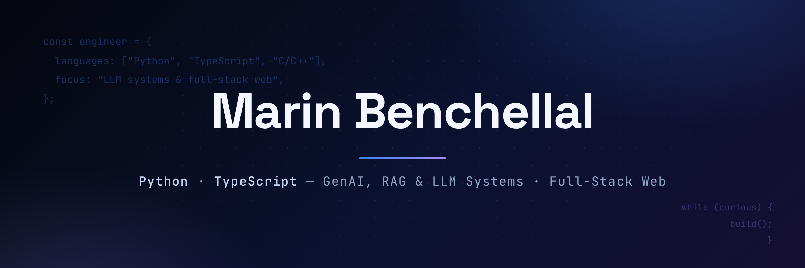

  

# Hi, I'm Marin 👋

- 🎓 Software Engineering at **1337 Coding School (42 network)** — project-based, peer-driven
- 🤖 Completed a **Software & AI engineering internship at BCG X** (Casablanca, 2026) — building generative-AI use cases for industry, working alongside senior engineers
- 🛠️ I build **LLM systems (RAG, agents, routing)**, **full-stack TypeScript web apps**, and low-level projects in **C/C++**

<<<<<<< HEAD
- 🎓 Software Engineering at **1337 Coding School (42 network)** — peer-driven, project-based learning with strict technical requirements
- 🤖 Completed a **Software & AI engineering internship at BCG X** (Casablanca, 2026) — designing and building generative-AI use cases for industry, working alongside senior engineers in the Software & AI practice
- 🛠️ What I like building: **LLM routers & agents, RAG systems, fine-tuning experiments, real-time web apps**, and from-scratch systems programming in C/C++
- 🌍 Fluent in Arabic, French, English & Spanish
=======

>>>>>>> 6e3f352 (Compact profile: new banner, Python highlighted, 3 featured projects)

## 🔥 Featured Projects

| | Project | What it is |
|---|---|---|
| 🧠 | **[laya-model-router](https://github.com/marn11/laya-model-router)** | Self-hosted LLM router that classifies task difficulty and dispatches each request to the right model — cheaper answers for easy prompts, stronger models for hard ones |
| 🏓 | **[nextjs-pong-game](https://github.com/marn11/nextjs-pong-game)** | Multiplayer real-time Pong platform: live game sync, matchmaking, tournaments, JWT + OAuth2 auth, chat & notifications — fully Dockerized |
| ⚽ | **[rag-footy-quiz](https://github.com/marn11/rag-footy-quiz)** | RAG-powered football quiz — retrieval-augmented generation over football data |

---

📫 **benchellalmarin1@gmail.com** · [LinkedIn](https://www.linkedin.com/in/marin-benchellal) · [Medium](https://medium.com/@marinbenchellal)

*Open to software engineering roles — full-stack, backend, and GenAI.*

