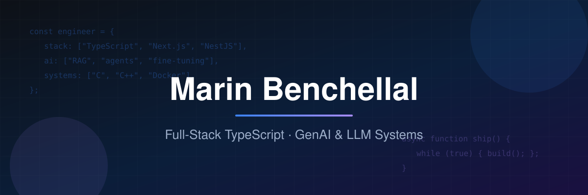

  

# Hi, I'm Marin 👋

I'm a software engineer focused on **full-stack TypeScript** and **GenAI / LLM systems**.

- 🎓 Software Engineering at **1337 Coding School (42 network)** — peer-driven, project-based learning with strict technical requirements
- 🤖 Completed a **Software & AI engineering internship at BCG X** (Casablanca, 2026) — designing and building generative-AI use cases for industry, working alongside senior engineers in the Software & AI practice
- 🛠️ What I like building: **LLM routers & agents, RAG systems, fine-tuning experiments, real-time web apps**, and from-scratch systems programming in C/C++
- 🌍 Fluent in Arabic, French, English & Spanish

---

## 🔥 Featured Projects

### 🧠 AI / LLM Systems

**[laya-model-router](https://github.com/marn11/laya-model-router)** — Self-hosted model router that classifies task difficulty and dispatches requests to the right LLM. Cheaper answers for easy prompts, stronger models for hard ones.
`Python` `LLM Routing` `Calibration`

**[rag-footy-quiz](https://github.com/marn11/rag-footy-quiz)** — RAG-powered football quiz: retrieval-augmented generation over football data.
`RAG` `Python` `LangChain`

**[langchain-langgraph](https://github.com/marn11/langchain-langgraph)** — A collection of agent patterns built with LangChain & LangGraph: multi-agent supervisors, human-in-the-loop, deep agents and more.
`LangGraph` `Agents` `Python`

**[laya-plays-subway-surfers](https://github.com/marn11/laya-plays-subway-surfers)** — Fine-tuning a model to play a JS endless-runner clone by picking actions from game state (no vision needed).
`Fine-tuning` `Reinforcement-style` `JS`

**[laya-plays-hangman](https://github.com/marn11/laya-plays-hangman)** — A chalkboard-themed Hangman game + control bridge for a calibrated decision model.
`TypeScript` `Decision Models`

**[coding-agent](https://github.com/marn11/coding-agent)** — Built my own coding agent from scratch, because a coding agent is a loop and 300 lines of code. (S/O @ghuntley)
`Agent Loop` `Python`

### 🌐 Full-Stack Web

**[nextjs-pong-game](https://github.com/marn11/nextjs-pong-game)** — Multiplayer real-time Pong platform (42's ft_transcendance): live game sync, matchmaking, tournaments, JWT + OAuth2 auth, chat & notifications, fully Dockerized.
`Next.js` `Fastify` `SQLite` `WebSockets` `Docker`

**[pollie](https://github.com/marn11/pollie)** — Polling web app: create polls, vote, and view results in real time.
`Next.js` `NestJS` `PostgreSQL`

**[text-justification](https://github.com/marn11/text-justification)** — RESTful API implementing a text justification algorithm, with token-based auth and fixed-window rate limiting.
`TypeScript` `API Design` `Rate Limiting`

**[CabinCare-Manager](https://github.com/marn11/CabinCare-Manager)** — Full-stack cabin maintenance manager: registration, task workflows, analytics dashboard, one-script automated setup.
`Next.js` `NestJS` `PostgreSQL` `Docker`

### ⚙️ Systems Programming (42)

**[Unix-shell-lookalike](https://github.com/marn11/Unix-shell-lookalike)** — Minishell: a Bash implementation from scratch (parsing, redirections, pipes, built-ins, signals).
`C`

**[C-Raycaster](https://github.com/marn11/C-Raycaster)** — Cub3D: a raycasting engine rendering a 3D maze from a 2D map, in C.
`C` `Graphics` `Math`

**[FT_IRC](https://github.com/ASTRO-47/FT_IRC)** — An IRC server from scratch, built with a team of 3: multiplexed I/O, channel & user management.
`C++` `Networking` `Sockets`

---

## 🧰 Tech Stack

 

 

---

## 📊 GitHub Stats

  
  

---

📫 **benchellalmarin1@gmail.com** · [LinkedIn](https://www.linkedin.com/in/marin-benchellal) · [Medium](https://medium.com/@marinbenchellal)

*Open to software engineering roles — full-stack, backend, and GenAI.*

